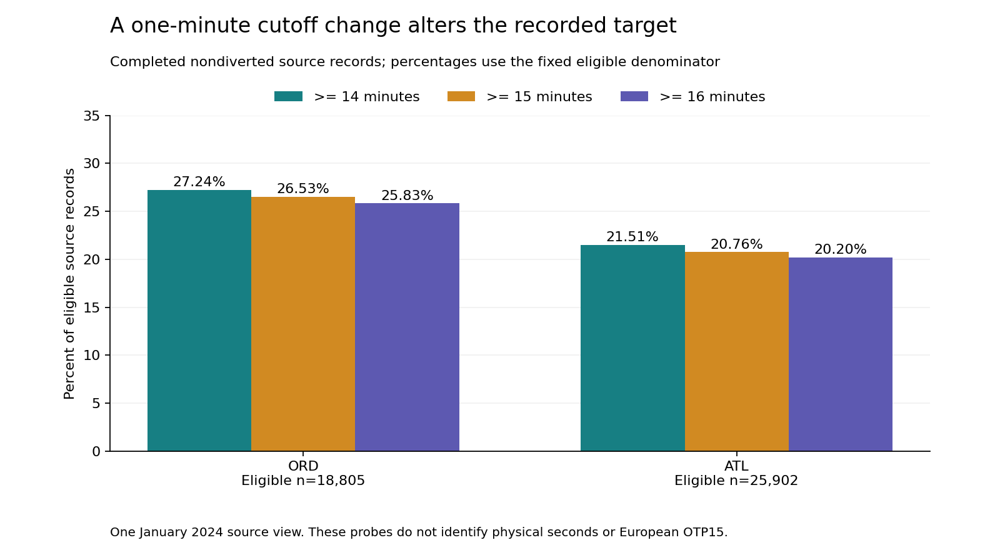

# Arrival-delay labels at the minute boundary

A one-minute change in a delay cutoff changes the target even when the flights stay the same. This study measures that difference for every January 2024 reporting-carrier arrival to ORD and ATL in the official BTS archive.

**Finding:** 275 of 44,707 eligible completed nondiverted records change labels between recorded cutoffs of 15 and 16 minutes. The affected count is 131 of 18,805 at ORD and 144 of 25,902 at ATL: rate differences of 0.697 and 0.556 percentage points. These are recorded-minute sensitivity measures; physical-second lateness and European OTP15 equivalence remain unknown.

## Practical use

Keep the source field, exact cutoff and eligible denominator with every benchmark label. Before pooling systems, reconstruct compatible targets from supported source observations. Retain cancellations, diversions and unknowns beside completed-flight rates.

The runnable [implementation exercise](EXERCISE.md) returns qualified recorded-minute counts and rejects unsupported European, physical-second, safety-ranking and transfer requests. It includes seven complete requests, two accepted and five rejected.

~~~powershell
python -m pip install -r requirements.txt
python src/replay.py --out ../arrival-label-replay
~~~

Use a new output directory. The saved-data replay verifies the freeze and source mapping, reproduces six result files, runs independent SQL/exact-rational checks and fixtures, and checks actual figure geometry and manuscript values. It does not reacquire mutable source data or establish original publication timing.

## Evidence underneath

- [Six-page independent manuscript](paper/manuscript.pdf), [LaTeX](paper/main.tex), and three original figures. Not peer reviewed.
- Complete [airport accounts](results/airport_accounts.csv), [all 62 airport days](results/daily_accounts.csv), [26 carrier cases](results/carrier_accounts.csv), [270 threshold cases](results/threshold_cases.csv), [summary](results/summary.json) and [requests](results/exercise.json). Empty carrier cross-cells and unavailable rates are retained.
- [Fixed protocol](PROTOCOL.md), [26-dependency freeze](PLAN_FREEZE.json), [source contract](data/source_contract.json), [native verification](data/native_verification.json), [source meanings](data/README.md) and [data rights](DATA_RIGHTS.md).
- Independent native reconciliation: 131,867 finite conditions across 547,271 national rows, 46,621 selected arrivals and 21,303 sufficient cells. Saved-source checks: 191,424. Independent SQLite/Fraction analysis: 2,947. All 29 authored fixture methods pass.
- Separate full-history CPython [3.10.11](results/reproduction_cpython310.json) and [3.12.14](results/reproduction_cpython312.json) replays reproduce six files exactly with all ten source-directory files unchanged in each.
- [Figure verification](figures/verification.json): 90 source-bound bars, 360 actual SVG coordinate conditions, nine asset hashes and 766 finite conditions. [Paper verification](paper/verification.json) checks actual used source bindings, complete tables, current output/figure hashes and all six reviewed pages.

## Scope and limits

One winter month, two fixed destination codes and one reporting-carrier dataset form a convenience cohort. The cutoff at 15 follows the source indicator; 14 and 16 are prespecified sensitivity probes. Source values were visible during capture and reconciliation; the 26 actual dependencies were committed before threshold comparisons. This was source informed, not blinded.

ORD retains 1,479 cancelled and 43 diverted records outside the eligible denominator; ATL retains 311 and 81. The source indicator agrees for all eligible records in this finite cohort. That agreement does not establish physical seconds, general source accuracy, carrier quality or cross-system equivalence. Current historical data may be revised; this is not an immutable original-vintage capture.

The [original US-to-Europe transfer question remains unexecuted](SOURCE_HISTORY.md). No European values are transformed or scored. No model, new estimator, airport safety/quality ranking, causal effect, deployment or realized saving is claimed.

The [failed download-form receipt](SOURCE_ACCESS.md) remains historical evidence. BTS's official archive directory supplied a direct link to the identical fixed January file; that transport change was committed before its body was read. The current capture and results supersede the dated pending phase without changing the frozen history.

Public artifacts contain minimal federal statistical counts and independent results. Native flight identities, tail numbers and raw source files remain private. Separate formal-publication projects, including Azure optimization, remain private. Original code is MIT licensed; DOT/BTS facts are attributed separately. DOT/BTS does not endorse this independent analysis.
